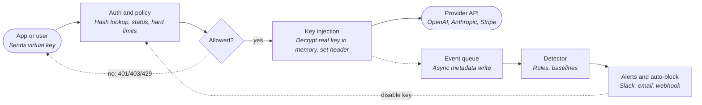

# Open-source API key proxy: research and 12-week plan

> A security-first, self-hostable proxy that holds real third-party API keys, issues virtual keys, watches for suspicious use and can revoke. The category has real competitors, so this page names the narrow wedge, the architecture, the risks and a plan to find out in 12 weeks whether to build a hosted product.

## Contents

- Bottom line
- 1. Competitor landscape
- 2. Positioning and first users
- 3. Architecture
- 4. Detection rules
- 5. Threat model and trust
- 6. 12-week plan and metrics
- 7. Monetization, risks, open questions
- Sources

## Bottom line

> **Build it, but narrow the claim.**
>
> Virtual keys, budgets and rate limits are already free in LiteLLM, Bifrost and others. What I did not find, in open source, is a small self-hosted proxy whose main job is detecting and containing misuse of a key, with opt-in auto-revoke, for any bearer-token API. A hosted competitor (INFRO) documents similar signals, mostly as roadmap. The agreed plan holds up, with a week 0 validation step and some scope cuts below.

- Wedge: blast-radius control and fast containment for leaked or abused keys. Not another LLM router.
- Biggest risk: trust. You are asking people to hand over production keys. Self-hosted first, with no logging of bodies, is the only credible start.
- Second risk: false positives. Alert-only by default, and hard limits the customer sets are the only things that block inline by default.
- Third risk: Cloudflare (free), LiteLLM (huge), and incumbents like Infisical and Palo Alto entering adjacent ground.
- Cut from weeks 1-3: custom Anthropic and Stripe parsing. Ship OpenAI-compatible fully, add Anthropic next, and treat Stripe and others as generic bearer passthrough with path allowlists.

## 1. Competitor landscape

Research done on 2026-10-27 from vendor docs, pricing pages and GitHub pages (links in Sources). Where I could not verify something it says so. Pricing changes often, so re-check before you quote any of it.

### LLM gateways with virtual keys

| Product | Open source? | Virtual keys? | Anomaly detection / auto-block? | Pricing model | Gap |
| --- | --- | --- | --- | --- | --- |
| LiteLLM proxy | Yes, MIT core. Enterprise features behind a license key (SSO/SCIM, audit logs, secret managers, IP allowlists, key rotation). | Yes: virtual keys, per-key budgets and TPM/RPM limits (budgets need Postgres). | No anomaly detection found in docs. Has Slack/webhook budget alerts (budget_crossed, projected_limit_exceeded). Budget cap blocks; nothing auto-revokes on behavior. | Free self-host. Enterprise sized to annual request capacity, quote-based, not per token. | Built for routing 100+ models and team spend control, not abuse response. Python plus Postgres is heavy for a small team. Per-key rules are about budget, not who is calling from where. |
| Portkey gateway (now Prisma AIRS AI Gateway) | Gateway is MIT on GitHub (about 13k stars in the snapshot I read). Palo Alto Networks completed its acquisition; GA of the Prisma AIRS AI Gateway was July 16, 2026. | Yes: virtual keys with budgeting and rate limits (docs mention a shift to a Model Catalog in Feb 2026, so re-check current terms). | Guardrails (content). No key-behavior anomaly detection found. | Pre-acquisition list prices: Free 10K logs, $49/mo Production, custom Enterprise. Re-check, packaging may have changed. | Moving to an enterprise AI-security platform. Leaves the small-team, self-hosted, simple end open, but also shows big vendors want this category. |
| Helicone AI Gateway | Yes, Rust gateway. License is listed inconsistently (GPL-3.0 in repo metadata, Apache in the README); verify before relying on it. Small (about 640 stars in the snapshot). | API key management and custom rate limits mentioned; I did not verify per-user virtual keys. | No. Observability and caching focus. | Hosted: free 10K requests, Pro $79/mo, Team $799/mo, usage-based above included. | Observability-first. Detection and revocation are not the product. |
| Cloudflare AI Gateway | No (managed). Core features free on all plans. | Partly: BYOK stores provider keys; callers authenticate with a Cloudflare API token. Docs warn gateway tokens are account-scoped, so a token can use every gateway in the account. | No anomaly detection found. Has rate limiting, DLP scanning, guardrails (Workers AI billed). | Core free. Guardrails billed as Workers AI inference. Unified Billing adds 5% on credits. BYOK avoids that fee. | Strong free default for people already on Cloudflare. Not self-hosted, no per-caller virtual keys with behavior rules, vendor lock-in. |
| Bifrost (Maxim AI) | Yes, Go, Apache-2.0. | Yes: virtual keys with provider/model access, rate limits, hierarchical budgets (key, team, customer). | Not found in docs I read. | Free self-host. I did not research a paid tier. | Closest in tech stack to what you would build, and already has virtual keys and budgets. Competes on gateway features, not security response. |
| LangWatch AI Gateway | Gateway docs public; I did not verify the license of the gateway code. | Yes: disable, revoke (terminal), rotate (old secret works 24h). Audit trail per key. | No automatic detection found; docs describe a manual incident runbook for leaked keys. | Not researched. | Shows the disable/revoke/rotate semantics users expect. Response is manual. |
| INFRO | Not verified. | Yes: gateway keys with limits, allowed networks (IP), model lists, expiry. | Closest to your idea. Docs list leak signals (6+ countries a day, 20x median volume, new model/provider, tripwire keys). Many are marked roadmap, and none refuse requests by design. | Not researched. | Hosted-only as far as I could tell, and detection mostly alert-only and unreleased. Evidence the need is real. Validate whether it ships. |

### API gateways and key-management for your own APIs

| Product | Open source? | Virtual keys? | Anomaly detection / auto-block? | Pricing model | Gap |
| --- | --- | --- | --- | --- | --- |
| Kong Gateway (OSS) and AI plugins | Yes: core Apache-2.0. Basic AI Proxy plugin is OSS. AI Proxy Advanced and AI Rate Limiting Advanced (token and cost limits) are Enterprise-only. | key-auth consumers plus rate-limiting per consumer. | No behavioral detection. | OSS free. Enterprise and AI add-ons are custom or tiered. | General-purpose, heavy to operate, and does not store third-party secrets for you. |
| Tyk | Gateway is MPL 2.0. Dashboard, portal, MDCB and ee features need a paid license. | Auth tokens and keys with quotas and rate limits. | No. | Quote-based. AWS Marketplace lists Tyk Core at $16,875 per 12 months. | Same as Kong: infrastructure for your own APIs, not an agent for protecting upstream vendor keys. |
| Unkey | Source-available (FSL-1.1-ALv2), self-hostable. External pull requests are paused. | Yes: issue, verify, revoke keys, with sliding-window rate limits and credits. | No. Verification and limits, with analytics and audit logs. | Free 150K valid requests/mo and 1,000 keys. Pro $25/mo for 250K requests up to $1,000/mo for 100M. | Solves the side of APIs you publish. Does not hold upstream third-party keys or run behavior rules. Also a signal that devs prefer source-available over pure OSS here. |

### Secrets managers

| Product | Open source? | Virtual keys? | Anomaly detection / auto-block? | Pricing model | Gap |
| --- | --- | --- | --- | --- | --- |
| HashiCorp Vault / OpenBao | Vault 1.15+ is BSL 1.1 (source-available). OpenBao is an MPL 2.0 fork of the last MPL Vault. | No. Dynamic secrets and leases for some backends, not request-path virtual keys. | No. | Vault: commercial. OpenBao: free. | Stores secrets and hands them to workloads. The workload still holds the real key. |
| Infisical | Yes: core MIT. Secret scanning needs an enterprise license when self-hosted. | No for the core manager. | No (scanning is for repos). | Cloud free up to 5 identities, Pro $20 per identity per month annually, Advanced $40, Enterprise custom. | Same as Vault for the core product. See Agent Vault in the next table. |
| Doppler | No. | No. | No. | Developer free up to 3 users, then $8 per extra user per month. Team $21 per user per month. Machine and agent identities are not charged. | Config and secrets sync. Workload still holds the real key. |

### Credential-broker proxies (closest in architecture)

| Product | Open source? | Virtual keys? | Anomaly detection / auto-block? | Pricing model | Gap |
| --- | --- | --- | --- | --- | --- |
| Infisical Agent Vault (open-source preview, April 2026) | Open-source preview is MIT (ee/ code excluded). A search summary reported it is no longer actively maintained, and the commercial Agent Vault is a separate preview product. I could not read the LICENSE or README directly. | Session tokens and access bundles instead of virtual keys. Per-agent scope by host, method and path. | No behavior detection described. Policy-based blocking (403 outside bundle), logs, 60s revocation. | Priced separately inside Infisical; I did not read the exact plans. | The most direct signal that the credential-broker proxy is a real category and incumbents are entering it. Aimed at AI coding agents (HTTPS_PROXY, TLS interception), not at app developers handing virtual keys to clients. |
| Small OSS projects (Keys on the Wire, Veil, Postern) | Yes: Apache-2.0 or MIT per a search summary; star counts and activity not verified. | No: they swap placeholders for real keys at egress. | No. | Free. | Local, single-user, agent-focused. No team model, alerts or anomaly rules. |

### Secrets scanners

| Product | Open source? | Virtual keys? | Anomaly detection / auto-block? | Pricing model | Gap |
| --- | --- | --- | --- | --- | --- |
| GitGuardian | No (commercial). Has a free Starter plan. | No. | Detects leaks, does not watch usage. Public monitoring only on Growth (limited) and Enterprise; price not public. | Free Starter, then paid plans; public monitoring is a licensed add-on. | Tells you after a key is already public. A proxy can make a leaked virtual key harmless or revoked in seconds. |
| TruffleHog | Yes, AGPL-3.0 scanner. Enterprise is commercial. | No. | Finds 800+ credential types and verifies if they are live by calling the provider. Not a runtime control. | OSS free. Enterprise quote-based (AWS Marketplace listing shows $100,000 per year, via private offer). | Detect and verify only. You could reuse its idea to detect your own virtual-key format. |
| GitHub secret scanning and push protection | No (platform feature). | No. | For partner token types leaked in public repos, GitHub notifies the provider, which may revoke. GitHub does not rotate keys itself. | Free for public repos. Private repos need paid Secret Protection per active committer. | Only helps for leaks in GitHub and only for partner formats. Does not cover keys leaked in logs, chat or client apps. |

### What providers already give you

| Provider | Native controls (so what your proxy must beat) |
| --- | --- |
| OpenAI | Per-project rate limits, model allow/deny lists and monthly spend limits. Keys can be restricted by endpoint scope. A per-API-key rate or spend limit is not supported (limits are org and project level). Hard spend limits may overshoot slightly. |
| Stripe | Restricted keys (rk_) with IP allowlist policies, or ASN/country allow rules. Rolling a key keeps old and new valid for up to 7 days. |

These controls cover a lot, which is why the wedge cannot be just limits. The gap they leave is per-caller keys with their own limits and instant revoke without rotating the upstream key.

### Why people care: abuse cost is real

Sysdig's LLMjacking research describes attackers using stolen cloud credentials to run LLMs on victims' bills. They estimated worst-case abuse of Claude 2.x on AWS Bedrock at about $46,080 per day and over $100,000 per day for Claude 3 Opus. In one later case they saw about $49,600 of usage over 4.5 days. These are cloud credentials, not API keys through a proxy, but they show the size of the downside you are selling against.

### Where the wedge is

- Nobody I found combines all of: self-hosted single binary, real-key custody, behavior-based alerts, opt-in auto-revoke, and non-LLM bearer APIs (Stripe, GitHub, SendGrid).
- LiteLLM and Bifrost compete on routing and budgets. Their detection is spend thresholds, not new-country or new-endpoint behavior.
- Agent Vault and similar tools target AI coding agents through a TLS-intercepting HTTPS_PROXY. You target app developers who hand keys to apps, clients and teammates.
- Scanners find leaks after the fact. You make a leaked virtual key worthless in seconds, without rotating the real key.
- Caveat: this wedge is thin and can be copied by LiteLLM adding rules. Speed, security reputation and ease of install are the moat, not the idea.

## 2. Positioning and first users

One-line pitch: Put your real API keys in a vault you control. Hand out virtual keys that can be limited, watched and revoked in one second.

**Best first users**

- Solo devs and small teams shipping an AI feature who share one OpenAI or Anthropic key between services, contractors and staging.
- Agencies and freelancers building for clients who want to revoke access at the end of a contract.
- Teams running internal tools or agents that call LLMs and Stripe or GitHub from several places.
- Indie SaaS founders who already had a leaked-key scare or a surprise bill.

**Poor first users (for now)**

- Large enterprises needing SOC 2, SSO and procurement. They want LiteLLM Enterprise or a platform vendor.
- Teams who just want model routing and fallbacks. They will pick LiteLLM or Cloudflare.
- Browser-only apps where the client IP is the end user's, which makes IP and country rules noisy.
- Anyone needing sub-millisecond latency or huge throughput on day one.

- **Where to find them:** Hacker News, r/selfhosted, r/LocalLLaMA and r/OpenAI, indie hacker communities, LiteLLM and Cursor issues where people complain about key sprawl, and your own network.
- **Message that tests well:** A concrete incident story and a 2-minute demo: leak a virtual key, see the alert, see it blocked, real key untouched.
- **Not the message:** 'Better than LiteLLM'. You are narrower and should say so.

## 3. Architecture

### Components and request flow

1. Client sends the request to the proxy with a virtual key (for OpenAI-style APIs, only the base URL and key change).
2. Proxy parses the key prefix, looks up its hash in an in-memory cache backed by the database, and checks status, expiry and allowed network.
3. Inline checks only do O(1) in-memory work: rate bucket, spend reservation, path and model allowlist.
4. Proxy resolves the upstream from the key's credential (fixed host, never from the request), decrypts the real key in memory, replaces the auth header and forwards.
5. Response is streamed back. Token usage is read from the response or the final stream chunk, cost is estimated and spend is reconciled.
6. A metadata event goes to a bounded queue. A background worker writes it, updates baselines and runs rules. Alerts go out, and auto-block flips the key to disabled if the customer opted in.

### Data model

| Table | Key fields | Notes |
| --- | --- | --- |
| tenant | id, name, wrapped_dek, kek_ref, created_at | One per team or install. Self-host: one default tenant. |
| upstream_credential | id, tenant_id, provider, host, auth_scheme, ciphertext, nonce, key_version, label | Real key, AES-256-GCM, tenant DEK, credential id as AAD. Write-only via API. |
| virtual_key | id, tenant_id, upstream_credential_id, prefix, secret_hash, status, expires_at, owner, labels | Status: active, disabled (reversible), revoked (terminal). Only a hash of the secret is stored. |
| policy | id, virtual_key_id, allowed_paths, allowed_models, rpm, daily_spend_cap, monthly_spend_cap, allowed_cidrs, allowed_countries, mode | Hard limits enforced inline. Mode: alert_only (default) or auto_block. |
| request_event | ts, virtual_key_id, ip, country, asn, method, path_template, model, status, latency_ms, req_bytes, resp_bytes, tokens_in, tokens_out, est_cost | Metadata only. No bodies, no headers, no query strings by default. Retention default 14 days. |
| baseline | virtual_key_id, window, rate_ewma, countries_seen, ips_seen, paths_seen, models_seen, spend_p95 | Rolling per-key profile used by anomaly rules. |
| detection | id, virtual_key_id, rule, severity, evidence_json, state, created_at | Evidence is counts and categories, never content. |
| alert_destination / delivery | id, tenant_id, type (slack, email, webhook), target, secret | Webhook signed with HMAC. Delivery attempts logged. |
| audit_log | ts, actor, action, target, before_json, after_json, ip | Append-only. Every admin action, key lifecycle, auto-block. |

### Key encryption

- Envelope encryption: a master key (KEK) wraps a data key (DEK) per tenant, and the DEK encrypts each credential with AES-256-GCM. The credential id is bound as authenticated data so ciphertexts cannot be swapped.
- KEK sources: env var or file (default for self-host), then AWS KMS, GCP KMS, Azure Key Vault or Vault Transit as a plug-in interface. With KMS, unwrap the DEK at startup and on rotation, not per request.
- Rotation: key_version on every credential, so rotating the KEK re-wraps DEKs only, and DEK rotation re-encrypts credentials in a background job.
- Real keys are write-only: no API returns them after creation. Show only the last 4 characters. The only reader is the injection path.
- Virtual keys: 32+ random bytes, shown once. Store only SHA-256 of the secret (the secret is high entropy, so a slow hash is not needed), with a visible prefix for lookup and for secret scanners.
- Honest limit: Go cannot reliably wipe memory. Anyone who can read the process memory can read the keys. Mitigate by isolating the process, not by claiming zeroization.

### Fail-open vs fail-closed

| Failure | Default | Why |
| --- | --- | --- |
| Key store unreachable, key not in cache | Fail closed | Cannot authenticate or fetch the real key. Return 503. |
| Key store unreachable, key cached | Serve from cache for a short grace (for example 5 min), then fail closed | Avoid outage from a brief DB blip. Revocations may be delayed during this window, so say so in docs. |
| Hard limits (rate, spend caps, allowlists) | Fail closed | Customer asked for these. Use in-memory state so the DB is not in the hot path. |
| Detection engine or alert delivery down | Fail open | Never take down customer traffic because an anomaly rule is broken. Count and report skipped events. |
| Event queue full | Drop oldest events, increment a visible counter | Protects latency. Surface it in metrics and in the dashboard. |
| Proxy itself down | Customer choice | Document the fallback honestly: apps can fall back to direct calls only if they also hold the real key, which defeats the point. Recommend running two instances. |

### Latency budget and streaming

| Step | Target |
| --- | --- |
| Key lookup, policy and rate checks (in memory) | under 0.5 ms |
| Decrypt and header swap (cached decrypted key in memory) | under 0.1 ms |
| Spend reservation and reconciliation | under 0.5 ms |
| Proxy overhead on the request path, p50 | under 3 ms |
| Proxy overhead, p99 (excluding upstream time) | under 10 ms |
| Event write and detection | Async, off the request path |

- These are targets to verify with a benchmark published in the repo, not measured results.
- SSE: flush every chunk, do not buffer, forward client disconnects upstream, and set no total timeout on streaming responses.
- Streaming spend: pre-reserve an estimate from max_tokens and model price, and for OpenAI-style streams request usage in the final chunk. If usage is missing, fall back to an estimate and mark the event as estimated.
- Do not cut a stream mid-response on a heuristic. Block the next request instead.
- Do not log or store prompts or responses. Do not run content inspection in v1.

### Tech stack recommendation

**Go (recommended)**

- Standard library reverse proxy and good SSE support, simple to build correctly.
- Single static binary, easy Docker image, easy cross-compile.
- Pure-Go SQLite driver keeps the binary CGO-free. Postgres via pgx for teams.
- Fast enough: this is I/O bound, and Bifrost shows a Go gateway is viable.
- Faster for one founder to ship in weeks than Rust.

**Trade-offs**

- GC pauses and no memory zeroing guarantees.
- Rust gives stronger memory safety and a good story for a security product, but slower iteration and a steeper hiring pool later.
- Python would be quickest to prototype but is a weak fit for the single-binary and latency story, and is where LiteLLM already is.
- Dashboard: ship as embedded static assets (small framework or server-rendered) so it stays one binary.

Suggested stack: Go, net/http reverse proxy, SQLite by default and Postgres optional, an in-process queue (add Redis or NATS only when you need multiple replicas), GeoLite2 or a similar local GeoIP database for country and ASN, Prometheus metrics, OpenTelemetry optional, cosign-signed images with an SBOM.

## 4. Detection rules

Principle: block inline only on rules the customer wrote (limits, allowlists). Everything inferred from behavior is an alert first. Auto-block is opt-in per key and needs repeated signals.

| Rule | When | Signal | Action | False-positive handling |
| --- | --- | --- | --- | --- |
| Hard rate limit | v1 | Requests per minute and per second per key (token bucket) | Blocks inline | Customer sets the number. Return 429 with Retry-After and a clear error code. |
| Spend cap (hourly, daily, monthly) | v1 | Estimated cost from usage fields, reserved before the call and reconciled after | Blocks inline | Soft threshold at 80% alerts first. Cap can be raised temporarily from the alert. |
| Path and model allowlist | v1 | Key may only call listed endpoints or models | Blocks inline | Default templates for common SDK calls so users do not hand-write lists. |
| Rate spike vs baseline | v1 | Requests in 5 min above max(floor, 10x the key's median 5-min rate over 7 days) | Alert | Needs a minimum absolute floor and a learning period (first 7 days or 500 requests) so new keys do not fire. |
| Spend spike | v1 | Spend in last hour above floor and multiple of same-hour baseline | Alert, optional auto-block | Floor in dollars, so tiny keys never alert. Include which model drove it. |
| New country or ASN | v1 | First request from a country or network never seen for this key | Alert, optional auto-block if repeated | Learning period. Known cloud ranges and deploy changes cause noise, so let users 'mark as me' and add CIDR or ASN allowlists. |
| Allowed CIDR or country violation | v1 | Request outside the key's configured network or country list | Blocks inline | Strong signal because the customer defined it. |
| Upstream auth errors burst | v1 | A burst of upstream 401/403 means the real key is revoked or someone is probing | Alert | Dedupe per key. Different message for 'provider key broken' vs 'caller probing'. |
| Retired or disabled key presented | v1 | A revoked or disabled virtual key is still being used | Alert | High signal: a copy exists. Count by IP and country. |
| New endpoint or model for this key | v1.1 | Path template or model not seen in baseline | Info or alert | Low confidence alone. Only escalate when combined with another signal. |
| Many distinct IPs | v1.1 | More than N new IPs in an hour for a key that normally has few | Alert | Mobile and NAT-heavy apps are noisy. Make threshold per key, off by default for browser-origin keys. |
| Tripwire (canary) keys | v2 | Fake virtual keys you plant in repos and docs. Any use fires | Alert, near zero false positives | Needs a distinct key prefix that scanners can match, and a clear 'this is a canary' label. |
| Distillation-shaped or scraping traffic | v2 | Flat 24h rate, high output tokens per request | Alert only | Batch jobs look the same. Never auto-block on this. |
| Provider-side usage mismatch | v2 | Provider reports usage that did not go through the proxy, so the real key leaked | Alert | Needs provider usage API credentials. Strongest sign the upstream key itself is loose. |
| Learned model (statistical or ML) | v2 (hosted) | Multi-signal scoring across keys and tenants | Alert | Do this only after you have real data and labeled feedback from users. |

### False-positive handling (applies to all behavior rules)

- Learning period per key (7 days or 500 requests) where behavior rules only record.
- Absolute floors on every ratio rule, so a key that goes from 2 to 30 requests never fires.
- Dry-run mode: show 'would have blocked' counts before auto-block can be enabled, and require the user to review it.
- Auto-block needs N signals of at least medium severity inside a window (for example 3 in 15 minutes), a cooldown, and uses disable (reversible) before revoke (terminal).
- 'This was me' button in Slack and email adds the country, ASN or CIDR to the key's allowlist and updates the baseline.
- Alert dedupe, snooze, quiet hours, and per-rule severity overrides. One incident gets one thread, not fifty messages.
- Per-rule precision tracking: record how many alerts were dismissed as 'this was me'. Turn off or retune rules that are mostly dismissed. Show this in release notes.
- Evidence in every alert: what fired, the baseline, the observed value, and one-click actions (disable, lower limit, allowlist).

## 5. Threat model and trust risks

> **The proxy is a vault of production keys. Treat that as the core product risk, not an afterthought.**
>
> If someone compromises the proxy they get every upstream key. Your job is to make that harder than compromising the app that previously held the key, and to be honest about what you do not protect against.

| Threat | Impact | Mitigation |
| --- | --- | --- |
| Attacker reads database or backups | Real keys exposed | Envelope encryption, KEK outside the database (KMS option), encrypted backups, no plaintext keys in logs. |
| Attacker gets code execution on proxy host | All active keys readable from memory | Run as non-root in a minimal container, no shell, read-only filesystem, network egress limited to provider hosts. State clearly that memory compromise defeats this. |
| Virtual key steals real key through SSRF or host override | Real key sent to attacker host | Upstream host is fixed per credential and never taken from request data. Block redirects to other hosts. Strip and reject headers like X-Forwarded-Host that could change routing. |
| Real key echoed back in error or logs | Leak to client or log system | Redact auth headers everywhere, never reflect upstream request headers, tests that assert no key material in any log line. |
| Admin API abused | Keys created, revoked or credentials replaced | Admin API on a separate port or Unix socket, strong admin token, audit log of every action, no API to read real keys, optional mTLS. |
| Stolen virtual key | Abuse up to configured limits | Per-key limits, network and country rules, instant disable, detection. This is the case the product is built for. |
| Denial of service | Outage of all apps using the proxy | Per-IP limits on unauthenticated requests, request and header size limits, timeouts, bounded queues. Document a two-instance setup. |
| Supply chain attack on your releases | Backdoor in every install | Few dependencies, pinned and audited, signed releases and images (cosign), SBOM, reproducible builds where possible, 2FA on all accounts, protected release branch. |
| Hosted version breach | Trust loss across customers | Do not hold customer keys in the hosted control plane. Use a split design: data plane (holds keys) stays self-hosted, control plane (dashboard, SSO, alerts) sees metadata only. |
| Malicious or curious maintainer or insider | Silent exfiltration | Open source, public release process, no telemetry by default, eventually an independent security audit. |

### Trust-building commitments (put these in the README)

- Self-host first. No account, no phone-home, no telemetry by default.
- No request or response bodies logged or stored by default. Metadata only, 14-day default retention, configurable.
- Real keys are write-only and never shown again.
- Published threat model with a list of what is not protected.
- SECURITY.md with a disclosure address, response times and a bug bounty-style thank-you list. Pay for an independent audit once there is revenue or a grant, and publish the report.
- Signed releases, SBOM and a short 'how to verify your download' page.
- Advise users to still use provider-side limits (OpenAI project spend limits, Stripe restricted keys with IP policies) as a second layer.

## 6. 12-week plan and metrics

### Week by week

| Week | Theme | Work | Exit check |
| --- | --- | --- | --- |
| 0 (before week 1) | Validate | Talk to 10 people who run OpenAI or Anthropic keys in production, side projects or agents. Ask about incidents, current tooling, and whether they would route traffic through a proxy. | 5+ conversations done, 3+ describe a real incident or near miss |
| 1 | Skeleton | Repo, license, single binary, reverse proxy to OpenAI, encrypted credential storage, virtual key issue and verify, Docker image. | curl through the proxy returns a real completion with a virtual key |
| 2 | Core policies | Per-key rate limit, spend cap with usage parsing, instant revoke/disable, admin API and CLI, streaming (SSE) pass-through. | Revoke blocks the next request. Streaming works with the official OpenAI SDK |
| 3 | More providers | Anthropic, then generic bearer passthrough profile (header-based). Stripe as a generic profile with path allowlist, not custom parsing. | Three providers through one binary. Load test baseline recorded |
| 4 | Event pipeline | Metadata events in SQLite (default) or Postgres, async writer, retention job, GeoIP lookup, per-key baseline. | Added latency p99 under 10 ms in the benchmark |
| 5 | Rules and alerts | v1 rules, severity, dedupe, Slack/email/webhook delivery, 'mark as me' action, dry-run mode. | Replayed attack scenario triggers the right alerts |
| 6 | Auto-block and hardening | Opt-in auto-block with N-strikes window and cooldown, audit log, SSRF and header hardening review, fuzz tests, signed release. | Self security review checklist passed. No known critical issues |
| 7 | Docs and threat model | README, 5-minute quickstart, threat model page, SECURITY.md, benchmark page, example integrations (Python, Node, curl). | A stranger completes the quickstart unaided in under 10 minutes |
| 8 | Dashboard and demo | Basic read-only dashboard (keys, requests, detections), demo video, 'attack simulation' script that shows an alert and auto-block. | Demo runs cleanly from a fresh clone |
| 9 | Launch | GitHub release, Show HN, relevant subreddits and communities, personal outreach to the people from week 0. | 5-10 early users install it, 3 give feedback |
| 10 | Learn | Triage issues, interview every active user, measure which rules fire and which are dismissed. | False-positive rate per rule known |
| 11 | Fix and extend | Top three requests, tune default thresholds, tripwire keys if users want them. | Week-over-week active installs rising or flat, not falling |
| 12 | Decide | Hosted version decision using the criteria in the monetization section. | Written go, pivot or stop decision |

### Week 1 day-by-day (starting Monday Nov 2, 2026)

1. **Mon: Decide scope and license; set up repo**: Pick language (Go recommended), license (Apache-2.0 core), name, domain. Repo with CI, linter, SECURITY.md stub. Write the one-paragraph promise and the non-goals list. Book 5 user conversations.
2. **Tue: Reverse proxy to OpenAI**: Minimal proxy that forwards /v1/* to api.openai.com with a hard-coded upstream key from an env var. Fixed upstream host only. Strip client Authorization and hop-by-hop headers. Test with curl and the official SDK, non-streaming.
3. **Wed: SSE streaming and timeouts**: Flush chunks as they arrive, propagate client cancel to upstream, set connect and header timeouts but no total timeout for streams. Test with stream=true and a cancelled request.
4. **Thu: Encrypted storage and virtual keys**: SQLite store. Envelope encryption: KEK from env/file, per-tenant DEK, AES-256-GCM per credential. Virtual key format with prefix, store only the hash. CLI: add credential, create key, list, revoke.
5. **Fri: Auth path and first limits**: Look up virtual key (cached), attach the real key, return clean errors for invalid, disabled or revoked. Add a basic per-key requests-per-minute limit. Docker image and a README stub.
6. **Sat/Sun: Demo and talk to users**: Record a 2-minute screen capture: store key, issue virtual key, revoke it. Send it to the people you spoke to. Note what they ask about first.

### Success metrics

| Metric | Week 9 (launch) | Week 12 (decision) | Notes |
| --- | --- | --- | --- |
| Design partners using it on real traffic | 2 | 5 | Most important. A partner is someone who sends production keys through it and gives feedback. |
| Active self-hosted installs (opt-in count or proxy-reported by users) | 10 | 30 | No telemetry by default, so ask users or use an opt-in ping. Do not count stars or pulls as installs. |
| GitHub stars | 300 | 1,000 | Vanity but helps credibility. Treat as a weak signal. A good HN launch can do more, a miss can do less. |
| Detections acted on (not dismissed) | - | At least 5 real | Proof the product caught something real or at least useful. |
| Quickstart completion time | under 10 min | under 5 min | Watch someone do it. |
| Proxy overhead p99 | under 10 ms | under 10 ms | From the benchmark in the repo. |
| Paying intent | - | 3 teams say they would pay for specific hosted features | Ask for a concrete price and a yes or no, not 'sounds interesting'. |

These numbers are my starting guesses for a solo launch, not benchmarks from other projects. Adjust after week 0 conversations.

## 7. Monetization, risks, open questions

### Monetization path

| Stage | What | Price hypothesis (untested) | Comparable |
| --- | --- | --- | --- |
| Open-source core | Self-hosted proxy, virtual keys, limits, detection, alerts, auto-block | Free | LiteLLM open core, Portkey gateway, Bifrost |
| Hosted control plane (first paid product) | Team access, dashboard, shared alert routing, longer retention, SSO, audit export. Data plane stays on the customer's side. | $29-49 per month per team, and a higher tier per seat for SSO | Portkey Production $49/mo, Unkey Pro from $25/mo, Helicone Pro $79/mo, Doppler Team $21 per user |
| Hosted data plane (later, if demanded) | You run the proxy for them with customer-managed KMS | Usage or key-count tiers | Unkey and Portkey tiered request plans |
| Enterprise | SSO/SCIM, RBAC, detailed audit logs, support SLA, security review help | Annual contract, quote | LiteLLM Enterprise is license-key based and sized to request capacity |

- License: Apache-2.0 for the core, with commercial features in a clearly separated directory. LiteLLM has a public issue about unclear MIT vs Enterprise boundaries. Avoid that confusion from day one.
- Alternatives considered: AGPL (blocks cloud resellers but scares some companies) and FSL or BSL (Unkey, Vault used them, but community pushback and forks like OpenBao followed). Your trust story favors a real open-source license.
- Keep these free in the core: virtual keys, limits, detection, alerts, auto-block. Charging for security basics hurts trust. Charge for team and compliance features and for not having to run the dashboard.
- Decision rule at week 12: go hosted if 3+ design partners ask for the same team feature and say they would pay, and active installs are growing. Otherwise keep it as an OSS project and consider sponsorship or consulting.

### Risks

| Risk | Likelihood | Mitigation |
| --- | --- | --- |
| Crowded space: LiteLLM, Bifrost, Cloudflare (free), incumbents like Infisical and Palo Alto (via Portkey) | High | Stay narrow on security response and non-LLM bearer APIs. Do not build routing or caching. Be easy to put in front of LiteLLM. |
| Users will not hand real keys to a new project | High | Self-host first, threat model, signed releases, small auditable codebase, publish what you do not protect. |
| False positives erode trust, or auto-block causes an outage | Medium-high | Alert-only default, dry-run, N-strikes, reversible disable, 'this was me' feedback, publish precision data. |
| Provider formats change and usage parsing breaks | Medium | Use generic bearer passthrough for non-OpenAI providers. Parse only usage fields. Add contract tests against recorded responses. |
| Solo founder support load on a security product | Medium | Narrow scope, good docs, clear SLA expectations, GitHub Discussions rather than live chat. |
| Legal and liability: holding customer secrets | Medium | Clear license disclaimer for OSS. For hosted: terms, DPA, split data-plane design, insurance and audit when revenue allows. Talk to a lawyer before the hosted launch. |
| Providers improve native controls (per-key limits, anomaly alerts) | Medium | Multi-provider and per-caller virtual keys remain your value. Watch OpenAI, Anthropic and Stripe release notes. |
| Wedge claim is wrong because INFRO or others already ship detection | Medium | Week 0: try INFRO, LiteLLM and Cloudflare, and re-check LiteLLM release notes monthly. |

### Open questions to answer early

1. Who exactly feels this pain strongly enough to switch: solo devs, agencies or small SaaS? Week 0 interviews should decide.
2. Is a stolen virtual key the real problem, or is it a leaked real key sitting in someone's env file? If the real key still exists elsewhere, the proxy does not protect it. How do you get users to remove it?
3. Should the data plane ever be hosted by you, and would customers accept it with customer-managed KMS?
4. Which providers matter first after OpenAI: Anthropic, Stripe, GitHub, Twilio, SendGrid? Ask users, do not guess.
5. How to get country and ASN without a license problem (GeoLite2 needs registration and terms, DB-IP lite has its own terms)? Check licenses before bundling.
6. Is a TLS-intercepting forward proxy (Agent Vault style) worth supporting later, or does the base-URL reverse proxy cover your users?
7. Name, domain, and trademark check. Not researched here.
8. Do you want to commit to a security audit and a bug bounty, and when?

---

## Sources

All pages were read via web search or fetch on 2026-10-27. Anything described as reported came from a search summary and was not confirmed on the primary page.

- [LiteLLM documentation](https://docs.litellm.ai/index.md) (docs.litellm.ai)
- [LiteLLM budgets and rate limits](https://docs.litellm.ai/docs/proxy/users) (docs.litellm.ai)
- [LiteLLM Enterprise](https://docs.litellm.ai/docs/enterprise) (docs.litellm.ai)
- [LiteLLM pricing](https://www.litellm.ai/pricing) (litellm.ai)
- [LiteLLM alerting and webhooks](https://docs.litellm.ai/docs/proxy/alerting) (docs.litellm.ai)
- [LiteLLM: unclear MIT vs Enterprise boundaries (issue)](https://github.com/BerriAI/litellm/issues/34241) (github.com)
- [Portkey gateway repository](https://github.com/Portkey-AI/gateway) (github.com)
- [Portkey pricing](https://portkey.ai/pricing) (portkey.ai)
- [Palo Alto Networks completes acquisition of Portkey](https://www.paloaltonetworks.com/company/press/2026/palo-alto-networks-completes-acquisition-of-portkey-to-secure-ai-agents) (paloaltonetworks.com)
- [Prisma AIRS AI Gateway general availability](https://www.paloaltonetworks.com/blog/2026/07/announcing-general-availability-of-prisma-airs-ai-gateway/) (paloaltonetworks.com)
- [Helicone AI gateway repository](https://github.com/helicone/ai-gateway/) (github.com)
- [Helicone pricing](https://www.helicone.ai/pricing) (helicone.ai)
- [Cloudflare AI Gateway pricing](https://developers.cloudflare.com/ai-gateway/reference/pricing/) (developers.cloudflare.com)
- [Cloudflare AI Gateway BYOK](https://developers.cloudflare.com/ai-gateway/configuration/bring-your-own-keys/) (developers.cloudflare.com)
- [Cloudflare AI Gateway authenticated gateway](https://developers.cloudflare.com/ai-gateway/configuration/authentication/) (developers.cloudflare.com)
- [Bifrost repository](https://github.com/maximhq/bifrost/) (github.com)
- [Bifrost virtual keys](https://docs.getbifrost.ai/features/governance/virtual-keys) (docs.getbifrost.ai)
- [LangWatch credential-leak incident response](https://langwatch.ai/docs/ai-gateway/cookbooks/credential-leak-incident) (langwatch.ai)
- [INFRO security signals](https://infro.io/docs/security/signals) (infro.io)
- [Kong AI Rate Limiting Advanced plugin](https://developer.konghq.com/plugins/ai-rate-limiting-advanced/) (developer.konghq.com)
- [Kong open source AI Gateway announcement](https://konghq.com/blog/product-releases/announcing-kong-ai-gateway) (konghq.com)
- [Tyk open source](https://tyk.io/docs/tyk-open-source) (tyk.io)
- [Tyk pricing](https://tyk.io/pricing/) (tyk.io)
- [Unkey repository](https://github.com/unkeyed/unkey/) (github.com)
- [Unkey pricing](https://unkey.com/pricing) (unkey.com)
- [Vault BSL license overview](https://www.stephane-robert.info/en/docs/devsecops/secrets/vault-bsl-license/) (stephane-robert.info)
- [OpenBao](https://openbao.org/) (openbao.org)
- [Infisical pricing](https://infisical.com/pricing) (infisical.com)
- [Infisical: Agent Vault open-source announcement](https://infisical.com/blog/agent-vault-the-open-source-credential-proxy-and-vault-for-agents) (infisical.com)
- [Infisical Agent Vault product page](https://infisical.com/platform/agent-vault) (infisical.com)
- [Doppler pricing](https://www.doppler.com/pricing) (doppler.com)
- [GitGuardian pricing](https://www.gitguardian.com/pricing) (gitguardian.com)
- [TruffleHog repository](https://github.com/trufflesecurity/trufflehog) (github.com)
- [GitHub secret scanning partner program](https://docs.github.com/code-security/secret-scanning/secret-scanning-partnership-program/secret-scanning-partner-program) (docs.github.com)
- [GitHub push protection](https://docs.github.com/en/code-security/concepts/secret-security/push-protection) (docs.github.com)
- [OpenAI spend limits](https://developers.openai.com/api/docs/guides/spend-limits) (developers.openai.com)
- [OpenAI managing projects](https://help.openai.com/en/articles/9186755-managing-projects-in-the-api-platform) (help.openai.com)
- [Stripe restricted API keys](https://docs.stripe.com/keys/restricted-api-keys) (docs.stripe.com)
- [Sysdig: LLMjacking](https://www.sysdig.com/blog/llmjacking-stolen-cloud-credentials-used-in-new-ai-attack) (sysdig.com)
