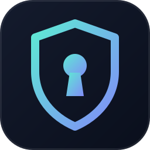

<p align="center">
  
</p>

<h1 align="center">Keman</h1>

<p align="center">
  <b>Open-source protection from leaked API keys.</b><br>
  A self-hosted proxy that keeps your real API keys and hands apps virtual ones you can lock, watch, and kill.
</p>

<p align="center">
  <a href="https://github.com/kirank55/keman/actions/workflows/ci.yml"></a>
  <a href="https://github.com/kirank55/keman/releases"></a>
  <a href="LICENSE"></a>
  
</p>

<p align="center">
  <a href="#install">Install</a> ·
  <a href="#try-it-in-60-seconds">Try it</a> ·
  <a href="#quickstart">Quickstart</a> ·
  <a href="#contain-a-leak">Contain a leak</a> ·
  <a href="SECURITY.md">Security</a>
</p>

API keys leak. They get committed to repos, pasted into CI logs, baked into images, and copied from laptops. Keman makes a leaked key worth much less, and easy to kill.

Keman is a self-hosted proxy that keeps your real API keys and hands out virtual ones. Apps send a `kmn_…` key. Keman checks it and forwards the request upstream with the real credential. The real key never leaves Keman, so when a virtual key leaks:

- **It may not work at all.** Lock each key to the addresses or countries it is used from. A copy used from anywhere else is refused.
- **It stops working on its own.** New keys expire after 90 days by default.
- **You hear about it.** Use from a new country or network, request and spend spikes, repeated blocked requests, and use of a disabled key raise alerts to Slack or a signed webhook. Each alert says who called and from where, and gives the exact command to respond.
- **Decoys catch the thief.** Canary keys never forward anything. Plant one in a repo or CI config, and any use raises a critical alert.
- **You kill it in one step.** `keman key rotate laptop --grace 0` issues a replacement with the same policy and revokes the leaked key. The real provider key stays the same, and so does every other app.

It is one Go binary with pure-Go SQLite, and needs no CGO. It works with OpenAI-compatible APIs (including OpenRouter), Anthropic, and any HTTP API that authenticates with a header, such as Stripe or GitHub. It runs on Linux, macOS and Windows, does not phone home, and is Apache-2.0.

> **Beta.** The spec is [`beta.md`](beta.md). Decisions the spec left open are in [`docs/ASSUMPTIONS.md`](docs/ASSUMPTIONS.md). Changes are in [`CHANGELOG.md`](CHANGELOG.md).

## Install

macOS and Linux:

```sh
curl -fsSL https://raw.githubusercontent.com/kirank55/keman/main/scripts/install.sh | sh
```

The script picks the binary for your OS and CPU, checks its SHA-256 sum (and its cosign signature, if `cosign` is installed), and installs it to `/usr/local/bin` or `~/.local/bin`. Read it first if you like: [`scripts/install.sh`](scripts/install.sh).

Other ways:

| | |
| --- | --- |
| Go 1.22+ | `go install github.com/kirank55/keman/cmd/keman@latest` |
| Docker | `docker pull ghcr.io/kirank55/keman:beta` (see [Docker](#docker)) |
| Windows, or by hand | Download `keman_<os>_<arch>` from [Releases](https://github.com/kirank55/keman/releases). Every binary has a SHA-256 sum, an SBOM, and a cosign signature ([how to verify](SECURITY.md#verifying-a-release)). |
| From source | `git clone https://github.com/kirank55/keman && cd keman && make build` |

## Try it in 60 seconds

**1. Find the keys you already leaked.** No server, no setup:

```sh
keman scan . --history
```

**2. See a week in the life of a team using Keman**, without a provider key. From a clone of this repo:

```sh
./scripts/demo.sh
KEMAN_ADMIN_TOKEN="$(cat .demo/admin.token)" .demo/keman --config .demo/keman.yaml
```

`demo.sh` builds Keman and seeds `.demo/` with seven keys, a week of normal traffic, and the incidents Keman exists to catch: a stolen key draining spend from a new country, a locked key tried from outside its network, a disabled key back in use, a provider key revoked upstream, a decoy that fired, and probes for endpoints a key may not call. Everything runs locally against a mock upstream. Alerts land in `.demo/alerts.jsonl`, and every address is from a documentation range.

**3. Put your own keys behind it.** See the [Quickstart](#quickstart).

## Find the keys you already leaked

`keman scan` needs no server and no setup. It looks for OpenAI, Anthropic, OpenRouter, Stripe, GitHub, Slack, Google and AWS keys, and Keman virtual keys, in files and in every commit on every branch:

```sh
keman scan . --history
```

```text
found 1 secret in 2 places

OpenAI  sk-proj-…x7Yq
  .env:4
  config/dev.env:2  (commit 3f9c1a2b7d10)
  Move it behind Keman so apps only ever hold a virtual key:
    keman upstream add --name openai --profile openai --host api.openai.com --port 443 --tls    (once)
    keman credential add --upstream openai --name openai-main --secret-env OPENAI_API_KEY
    keman key create --credential openai-main --name <app> --expires 90d
  It is in git history, so treat it as leaked: rotate it at OpenAI too.
```

Secrets are shown redacted. The exit code is 3 when anything is found, so `keman scan` can gate CI. `--json` prints machine-readable findings. Put `keman:allow` on a line to skip a test fixture.

## Quickstart

[Install](#install) Keman, then:

```sh
keman init    # prints the admin token once; writes keman.yaml and master.key here
keman         # opens the terminal UI and starts the proxy
```

In the UI:

1. Paste the admin token from `init`. It is masked and kept only in memory. Set `KEMAN_ADMIN_TOKEN` to skip this prompt.
2. Press `a` to add an upstream. OpenRouter is filled in as a suggestion. Use ←/→ on **profile** to switch to `anthropic` or `generic`, or edit any field.
3. The credential form opens. Type the provider API key (masked), or read it from an environment variable. It is stored encrypted and never shown again.
4. The new-key form opens. The `kmn_…` virtual key is shown **once**. Copy it. It expires in 90 days unless you change that with `p`.

Leave the UI open: quitting it (`q`) stops the proxy it started. To keep the proxy running without the UI, run `keman serve`. When a server is already up, `keman` connects to it and leaves it running on exit.

Run `keman` from the directory where you ran `init`, or pass `--config path/to/keman.yaml`.

### Point an app at Keman

Send the virtual key wherever the app expects its API key, and change the base URL:

| Client | Base URL |
| --- | --- |
| OpenAI Python / Node SDK | `http://127.0.0.1:8080/v1` |
| OpenRouter through Keman | `http://127.0.0.1:8080/api/v1` |
| Anthropic SDK | `http://127.0.0.1:8080` |

```sh
curl http://127.0.0.1:8080/api/v1/chat/completions \
  -H "Authorization: Bearer $KEMAN_KEY" \
  -H "Content-Type: application/json" \
  -d '{"model":"openai/gpt-4o-mini","messages":[{"role":"user","content":"hi"}]}'
```

Back in the UI, select the key and press Enter to see who called it and from where. Then press `p` and lock it to the addresses your app runs from: a copy used from anywhere else is refused.

### Try it without a provider key

[`./scripts/demo.sh`](scripts/demo.sh) seeds a full demo install (see [Try it in 60 seconds](#try-it-in-60-seconds)). For a minimal end-to-end check instead:

```sh
./scripts/quickstart.sh
```

The script builds Keman, initializes `.quickstart/`, starts a mock OpenAI server, creates a virtual key, sends one request through the proxy, then fires an allowlist detection with `keman detection test --live`. It prints the command to open the UI on that install. Set `KEMAN_QUICKSTART_PROXY_PORT` and `KEMAN_QUICKSTART_ADMIN_PORT` if 8080 or 8081 is taken.

## The terminal UI

The key list shows what matters if a key leaks: its **lock** (`ip`, `country`, `decoy`, or `open` when it works from any address), how many rules fired on it in the last 7 days, when it **expires**, and where it was **last seen**. A banner counts the keys that are open to every address, never expire, or sit unused.

Open a key to see its exposure findings with the command that fixes each one, who may use it, every client address that called it, its detections, and its recent requests. Spend and models appear only for LLM upstreams.

| Key | Does |
| --- | --- |
| `1`–`4`, `tab` | keys, detections, audit, setup |
| `j`/`k`, arrows | move or scroll |
| `enter` | open a key (also from a detection or an audit row) |
| `p` | policy: allowed addresses and countries, expiry, abuse mode, requests per minute, and daily and monthly caps in dollars for LLM keys |
| `r` | rotate: new key with the same policy; the old one stops after 24 hours, 1 hour, 7 days, or now |
| `n` | new virtual key (standard or canary) |
| `d` / `e` | disable / enable (reversible) |
| `x` | revoke (permanent; type the key's name to confirm) |
| `a` / `c` | add an upstream / a credential |
| `/` | filter the current view |
| `?` | help |
| `q` | quit, except while typing in a field. `ctrl+c` always quits. |

Switching a key to `auto_disable` shows the 7-day dry run first and asks for confirmation. `scan`, `exposure`, canary snippets, credential rotation, `rekey`, admin-token rotation and alert destinations are on the CLI.

## Contain a leak

| Situation | Command |
| --- | --- |
| A key leaked | `keman key rotate laptop --grace 0`: the app gets a replacement and the leaked copy is revoked now |
| Planned rotation | `keman key rotate laptop --grace 24h`: both keys work for a day, then the old one expires |
| Not sure yet | `keman key disable laptop`, and `keman key enable laptop` to undo |
| Keys that are easy to abuse | `keman exposure` lists keys open to every address, without expiry, or unused for 30 days, with the fix for each; `--strict` exits 3 |
| Lock a key down | `keman policy set laptop --cidr 203.0.113.0/24 --country US` |
| Change expiry | `keman key expiry laptop 30d` (or `2026-12-31`, an RFC3339 time, or `never`) |
| Plant a decoy | `keman canary create --credential primary --name repo-decoy --base-url https://keman.example.com >> .env` |

`canary create` prints only the lines a thief would expect, such as `OPENAI_API_KEY=kmn_…` and `OPENAI_BASE_URL=https://keman.example.com/v1`, so it can be appended straight to the file you plant it in. The base URL must reach your Keman proxy, or the canary cannot fire.

Alerts lead with the leak response. For a standard key, they offer rotate-and-revoke first, then disable, and only then the commands that allow the address or country that triggered them, in case it was you. A canary alert tells you to rotate the real secrets that were stored next to the decoy.

## CLI

Every operation is also a one-shot command, for scripts:

```sh
export KEMAN_ADMIN_TOKEN=kma_...
keman upstream add --name openai --profile openai --host api.openai.com --port 443 --tls
keman credential add --upstream openai --name primary --secret-env OPENAI_API_KEY
keman key create --credential primary --name laptop             # expires in 90 days
keman key create --credential primary --name ci --expires 30d
keman key create --credential primary --name decoy --kind canary
keman policy set laptop --cidr 203.0.113.7/32 --rpm 60
keman policy set laptop --mode auto_disable --yes
keman policy dry-run laptop
keman key rotate laptop --grace 24h
keman key expiry laptop 2026-12-31
keman key disable laptop
keman key enable laptop
keman key revoke laptop
keman exposure --strict
keman scan . --history
keman detection test
keman detection test --file events.jsonl --learned --expect spend_spike,new_country
keman canary create --credential primary --name repo-decoy --base-url https://keman.example.com
keman credential rotate primary --secret-env OPENAI_API_KEY
keman alert add --kind webhook --url https://example.invalid/hook --secret-file ./hook.secret
keman rekey --old-master-key-file ./old --new-master-key-file ./new
keman help
```

Keys, credentials and upstreams can be named by name or id. Put secrets in `--secret-env` or `--secret-file`, never on the command line. Global flags (`--config`, `--admin-url`, `--admin-token`) work before or after the subcommand. Without `--admin-url`, the CLI uses `admin_listen` from the config, including `unix://` sockets. After `init`, every change goes through the admin API, so a running server never holds a stale copy.

The proxy listens on `0.0.0.0:8080`. The admin API and `/metrics` listen on `127.0.0.1:8081` and require the admin token. Server settings are in `keman.yaml`; see [`examples/keman.yaml`](examples/keman.yaml). `serve` and the UI flush spend and drain the event queue on Ctrl+C or SIGTERM.

## Detection

- A new key learns for 7 days or 500 requests before spike and new-location rules alert. Normal traffic does not create detections.
- `keman detection test` replays built-in abuse scenarios and prints what would alert, including whether auto-disable and dry-run would trip. It runs on a fresh engine: it does not start the proxy, deliver alerts, or change a key. Exit code 1 means a scenario missed its expected result.
- `keman detection test --live --secret-file virtual.key` needs a running server. It sends five requests to a path the allowlist refuses, then waits until `allowlist_violations` is stored. `--proxy` overrides `proxy_listen` from the config. `./scripts/quickstart.sh` runs this against `.quickstart/`.
- `keman detection test --file events.jsonl` replays your own events, as a JSON array or as JSONL. Use `-` to read stdin. Each object can set `time`, `key_id`, `kind`, `ip`, `country`, `asn`, `status`, `cost_micro`, `model`, `blocked_code`, and `mode` (`alert_only` when omitted). `--learned` seeds every key with a baseline past learning: 500 requests, country US, ASN 64500, first seen 8 days before that key's first event. `--expect rate_spike,new_country` exits 1 when one of those rules does not fire. `--expect-disable` exits 1 unless auto-disable would disable the key, which requires `mode` `auto_disable` on the events.
- Rules: rate spike, spend spike, new country, new ASN, repeated allowlist violations, a burst of upstream auth errors, use of a disabled or revoked key, and canary use.
- Canary keys (`--kind canary`) answer with the profile's own 401 and raise a critical alert. They never reach the upstream.
- Country and ASN rules, and country allowlists, need a GeoLite2 or DB-IP `.mmdb` file in `geoip_country_db` and `geoip_asn_db`.
- `trusted_proxies` is empty by default. `X-Forwarded-For` from anyone else is ignored and is not sent upstream. All address rules use one client IP.
- New standard keys expire after `default_key_ttl` (default `2160h`, 90 days). Set it to `0s` to turn the default off.
- OpenAI and Anthropic have built-in path allowlists. Generic HTTP requires one, so a leaked key for a generic upstream can only call the endpoints you listed. Paths with `.` or `..` segments or backslashes never match, so `/v1/customers/../payouts` cannot slip past `GET /v1/customers/*`.

## Spend caps (LLM upstreams)

Runaway spend is often the first sign of a stolen LLM key, so OpenAI and Anthropic keys can also have daily and monthly caps.

- Money is integer microdollars. Prices ship in `internal/price/prices.json` (snapshot 2026-10-27).
- A model that is not in the price table is recorded with no cost. If the key has a spend cap, the request is refused with `unknown_model_price`. That includes OpenRouter's `vendor/model` ids. To cap those keys, add prices with `prices_file`. Prices are microdollars per million tokens, and the key is the `model` string exactly as the app sends it:

  ```json
  {
    "version": "local",
    "models": {
      "openai/gpt-4o-mini": {"input": 150000, "output": 600000}
    }
  }
  ```

- Generic HTTP does not support model allowlists or spend caps.
- Caps are reserved before the request and reconciled from usage. A missing usage object on a completed model response charges the reservation and marks it estimated. A dial failure, a blocked cross-host redirect, or a 3xx that is passed through releases the reservation.
- If spend flushes fail for 60 seconds, keys that have a cap get `503 store_unavailable`.

## Docker

```sh
docker volume create keman-data

docker run --rm -v keman-data:/home/nonroot ghcr.io/kirank55/keman:beta init
docker run --rm -p 8080:8080 -v keman-data:/home/nonroot ghcr.io/kirank55/keman:beta serve
```

The image is multi-arch (amd64, arm64), distroless, runs as non-root, and is signed with cosign. To build it yourself: `docker build -t keman:beta .`

`init` writes `keman.yaml`, `master.key` and the database to the volume, and prints the admin token. The admin listener stays on `127.0.0.1:8081` inside the container. Use `docker exec` for the CLI, bind a Unix socket on the volume, or set `KEMAN_ADMIN_LISTEN=0.0.0.0:8081` only on a private network. For production, keep the master key out of the data volume (see [`SECURITY.md`](SECURITY.md)).

## Develop

```sh
CGO_ENABLED=0 go test ./...
CGO_ENABLED=0 go build -o bin/keman ./cmd/keman
make fuzz
```

See [`CONTRIBUTING.md`](CONTRIBUTING.md). Tests use an injectable clock. Fuzz targets cover virtual-key parsing, header stripping and path matching. Proxy overhead is measured in [`benchmarks/RESULTS.md`](benchmarks/RESULTS.md). [`examples/sdk_stream.py`](examples/sdk_stream.py) and [`examples/sdk_stream.mjs`](examples/sdk_stream.mjs) stream through Keman with the official SDKs, and [`examples/mock-openai`](examples/mock-openai) is a local upstream for them.

## Security

Read [`SECURITY.md`](SECURITY.md) and [`docs/THREAT-MODEL.md`](docs/THREAT-MODEL.md) before exposing the proxy. Encryption does not help if the process memory is readable. The admin listener should not be reachable from the network.

## Release

Pushing a `v*` tag runs [`.github/workflows/release.yml`](.github/workflows/release.yml). It tests, then builds static binaries for Linux (amd64, arm64), macOS (amd64, arm64) and Windows (amd64), each with an SPDX SBOM (Syft), a SHA-256 sum and a keyless cosign signature, and publishes them with `install.sh` as one GitHub release. It also pushes a signed multi-arch image to `ghcr.io/kirank55/keman`. Release notes come from [`docs/releases/`](docs/releases/). Tags with a `-` are marked as prereleases.

Background research from before the beta is in [`docs/archive/PLAN.md`](docs/archive/PLAN.md).
